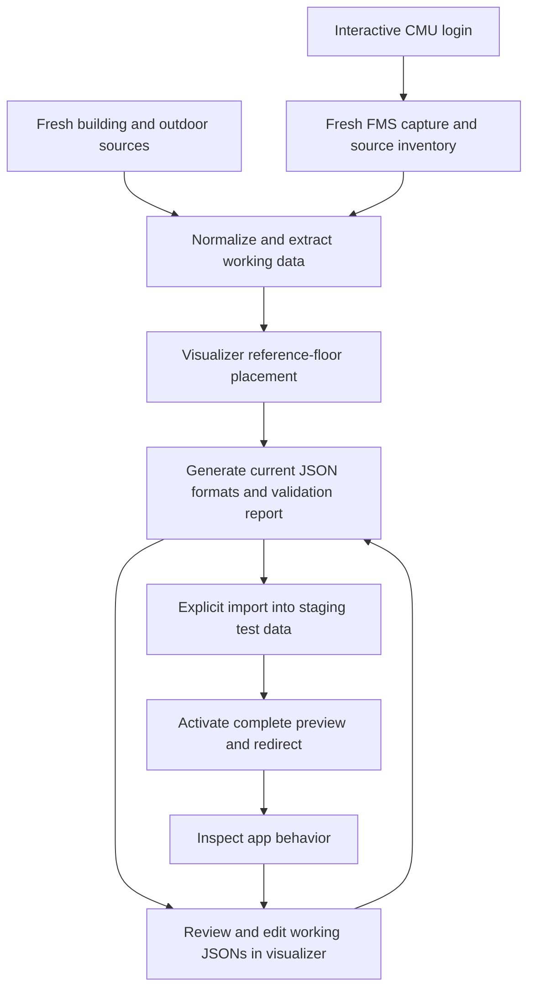

# Fresh-source data pipeline: v1 specification

Status: workflow agreed through the design interview; implementation not started.
Date: October 24, 2026.

## Goal

Make the complete CMU Maps data pipeline work consistently from a fresh scrape
through editable JSON generation, database import, and inspection in the app.
The first validation case is one building across its floors. The pipeline must
accept selected buildings/floors rather than hardcode that building.

This is temporary development tooling on a branch. Build only the structure
needed to run, resume, inspect, and improve the pipeline. Do not turn it into a
permanent data-management platform or spend v1 on publication infrastructure.
A downloader, a collection of unconnected scripts, or importing the old dataset
alone does not satisfy this specification.

## Agreed constraints

- Regenerate geometry and navigation data from fresh authoritative sources.
  Existing processed datasets are not required generation inputs.
- Preserve the existing application JSON formats and filenames.
- Use one pipeline engine from the CLI and visualizer. Source adapters and
  sequential stages are allowed; parallel legacy/manual generation pipelines are not.
- Allow manual placement of one reference floor per building in the visualizer.
  Derive other floor placements from verified FMS coordinate relationships.
- Treat saved working JSONs as authoritative. PostgreSQL is a derived preview and
  application store, not the master copy of edits.
- Save visualizer edits without running generation or database import on every
  drag. Build and load preview are explicit operations.
- Permit incomplete but structurally valid candidates in the test app with clear
  warnings. Structurally invalid output must not replace a working preview.
- Scope floor stacking to 2D alignment and navigable floor connections. A 3D
  building model is not required.
- Test each meaningful extraction/generation change through the affected complete
  path, including actual application behavior.
- Production publication, promotion policies, and permanent orchestration are out
  of scope for v1.

## Terms

| Term | Meaning |
| --- | --- |
| Capture | Saved responses, drawings, and source metadata from a live source session |
| Workspace | One named run in the temporary S3 bucket, with a local working cache |
| Working JSONs | Editable pipeline state, including saved placement and room information |
| Generated dataset | A validated export in the application's existing JSON formats |
| Preview | A generated dataset loaded into the isolated test backend/database and app |
| Import | Loading JSON records into PostgreSQL through the application import path |
| Reference floor | A floor placed by an operator to anchor a building's drawing frame |
| Source space | A source area/entity; it is not automatically a physical room or wall |

Import is the JSON-to-database step called serialization in the discussion. A
separate database-to-JSON serializer is not needed for the agreed JSON-first flow.

## End-to-end operator workflow

1. Select/create a named workspace and the buildings/floors to capture.
2. Authenticate to FMS using a normal interactive CMU login, including Duo when
   requested. Capture selected source data and a building/floor manifest.
3. Fetch the supporting public building/outdoor sources needed for the selection.
   Report source coverage and failures explicitly.
4. Normalize drawings and extract space geometry, labels, identifiers, and useful
   structured metadata into working data. Save the capture so processing can run
   again without another scrape or login.
5. Open that workspace in the visualizer. Inspect the fresh drawing/room candidates
   and place the building's reference floor. Save its placement in JSON.
6. Generate placements for the other floors from the verified shared coordinate
   relationship. Flag any inconsistent source frame rather than silently copying
   the reference floor's cropped-SVG placement.
7. Generate/update room records, classifications, label positions, graph data,
   building records, and POIs. Export the existing JSON files and a validation report.
8. Correct ambiguous labels, geometry, types, POIs, and connections through the
   visualizer. Changes update the selected working JSONs. Explicitly regenerate
   affected derived artifacts when necessary.
9. Explicitly load the selected generated dataset into the test environment.
   Activate it only after import and backend cache initialization succeed.
10. Navigate cleanly to the test app for that dataset. Check rooms, labels, aligned
    floors, routes, and POIs. Iterate using the same workspace and pipeline.

A fresh capture is an explicit operation. Reopening or rebuilding a workspace
uses its saved capture and working JSONs. Saving placement/corrections means
saving those JSONs, not maintaining a separate override/retention subsystem.
A new capture must not silently overwrite an operator's current workspace.

## Workspace and data flow

Use the existing temporary S3 bucket, configured by OpenBao's
`secret/secretspec/maps/dev/TEMP_DEV_S3`. Do not restore the old CDN/Garage source
selector. Credentials remain outside source control and browser-delivered assets.

Each workspace needs only:

- A small manifest: selection, source identities, capture time, phase status,
  artifact checksums, validation results, and the revision loaded in preview.
- Raw source responses and drawings. Store useful source data, not login cookies,
  passwords, or authentication-page responses.
- Working JSONs and saved placement/edit state.
- Generated application JSONs and a human-readable validation report.

Store these under a named workspace prefix, with a local cache for editing and
processing. Keep the standard generated files under the workspace's `floorplans/`
prefix. Selecting a prefix selects a dataset; it must not select a different
implementation of the pipeline.

Raw capture, editable state, and generated output are stages of one workspace.
They must not become independent competing sources of truth. Stage inputs and
invalidations must be explicit: for example, changing placement invalidates
geographic geometry and graph output; changing a room name need not rescrape FMS.
A full re-extraction that replaces edited working records must be explicit.

Use lightweight manifests/checkpoints and straightforward stage commands. Do not
introduce a workflow service, multiuser collaboration system, or permanent job
scheduler just to satisfy this lifecycle.

## Source capture and FMS discovery

### Required live scraper behavior

The FMS entry point must actually run the capture workflow. It must:

- Support a bounded building/floor selection and discovery of all floors in that
  selection. Do not require hand-editing a list of floor IDs in source code.
- Transfer the authenticated session into subsequent requests automatically.
  Keep session data local and temporary; detect expiry and request login again.
- Use TLS verification, bounded timeouts/retries, and actionable failure reporting.
- Reject access-denied/login HTML even if the server returns HTTP 200.
- Accept genuine SVG group fragments as well as standalone SVG documents.
- Capture required layers and metadata per floor, not only screenshots.
- Distinguish missing drawings, unavailable fields, and failed requests. Never
  report a complete scrape when selected floors were silently skipped.
- Handle the source drawing formats encountered in the selected building,
  including the CAD/Revit distinction. An unsupported floor remains an explicit
  incomplete result until it is supported.
- Resume an interrupted capture without repeating already verified downloads.

A source adapter may use browser/network discovery or structured exports. Prefer
structured source records over guessing from rendered text when both exist.
The browser session is an acquisition dependency; normalization, generation,
and offline tests must not require a logged-in browser.

### Useful FMS information to inventory and use

| Information | Intended use | Evidence/required investigation |
| --- | --- | --- |
| Building, floor, drawing and query identifiers | Discover manifests; associate entities and provenance | Verified in the ANSYS sample; check identity stability across captures |
| Boundary and selection paths/entity handles | Deduplicate geometry; retain source-to-output links | Verified; 42 area paths represent 21 unique boundary candidates in the sample |
| Text, coordinates, rotation and label handles | Room naming and label placement | Verified; text and boundary handles do not directly join |
| Drawing units, origin, transforms and shared building coordinates | Automatic floor alignment and geographic projection | Drawing transforms verified; common cross-floor frame/units still need live verification |
| Space/room IDs, use/function codes and reported areas | Room classification, label reconciliation and area checks | Investigate authenticated records and report exports |
| Physical walls, doors, openings and access attributes | Generate evidence-based walkable connections | Inspect architectural layers/typed records; not verified in the current capture |
| Stair/elevator/ramp identity and floor associations | Vertical connections and accessible routing | Inspect source records and cross-floor correspondence |
| Entrances/exits and building association | Connect indoor navigation to outside paths | Investigate FMS and supporting GIS data |
| Amenity/assets/capability records | Supported indoor POIs and destinations | Investigate availability; do not invent equipment from a generic room label |
| Names, numbering conventions and relevant non-personal classifications | Normalize room names and search aliases | Inspect source naming/use reports; do not assume department means public access |
| Source revision/update and format metadata | Diagnose changes and reproduce generation | Preserve where exposed; record absence where unavailable |

Discovery must produce an availability inventory with sample evidence, meaning,
and a proposed use for each useful field/layer. Keep extra useful metadata in the
capture/manifest instead of violating the current JSON schemas. Existing output
fields may be generated from better source methods as the implementation evolves.

CMU defines spaces that can be portions of rooms and can have phantom boundaries.
Therefore area polygons cannot automatically become physical walls or distinct
navigable rooms. Verify how records, room numbers, and architectural geometry
correspond before defining the conversion rules.
[CMU definitions](https://www.cmu.edu/enterprise-space/esim/process.html).

CMU documents room-use/area reports, stack plans, and report exports. Investigate
these as possible authoritative inputs; their public description does not prove
that the needed fields are exposed to our current FMS account.
[Space reporting](https://www.cmu.edu/enterprise-space/esim/services/reporting.html),
[database access](https://www.cmu.edu/enterprise-space/database/index.html).

## Geometry, placement and room generation

Normalize source geometry into a documented building/floor frame before applying
geographic placement. Preserve the original transforms, axis direction, origin,
units and source links in captured metadata.

The visualizer must be able to show an unplaced fresh drawing or room candidate
in its drawing frame. Do not require fabricated geographic coordinates or an
already populated database to perform first placement. This is a stage of the
same visualizer workflow, not a separate permanent placement application.

Manual placement saves the reference floor's geographic anchor, rotation and
scale. Verify a second fresh floor before relying on shared FMS coordinates.
Compose each floor's drawing normalization with the verified building frame and
reference anchor. Different SVG crops/viewboxes must not shift stacked floors.
Generate the existing per-floor placement records from that composition.

For room conversion:

- Reconstruct polygons from source paths, including transforms, holes, curves
  where present, and duplicate renderings. Do not count rendering duplicates as rooms.
- Reconcile source spaces with physical rooms using available structured metadata
  and geometry. Preserve source associations for inspection.
- Associate labels using source relationships where verified, otherwise geometry
  and confidence checks. Do not silently assign the nearest label to every polygon.
- Generate consistent room identifiers within the dataset, room numbers/names,
  label positions, types, floor references, polygons, and supported aliases.
- Use explicit use/type data before text heuristics. Unknown or ambiguous records
  remain flagged and editable; access restrictions cannot be inferred from a name alone.
- Preserve useful raw semantics separately while mapping output to the existing
  application room-type vocabulary.

The cached ANSYS sample demonstrates why review is needed: it has 21 boundary
candidates and 21 labels, but simple containment does not give every polygon one
unambiguous label. The converter must report ambiguous/unmatched entities.

## Graphs and POIs

Generate the graph from fresh room/architectural source data. Do not derive room
adjacency from the old `all-graph.json` as a required input.

The graph must connect relevant room access points, corridors, entrances, and
verified floor connectors. Sampling/triangulation can generate internal paths,
but touching polygons or a shared wall alone do not prove a doorway. Validate
that route segments remain in supported walkable geometry and do not cross walls.

Use explicit connector records/geometry where available. Match stairs/elevators
across floors with evidence, expose uncertain matches for correction, and keep
stairs out of routes marked accessible. Required links unavailable from sources
must be reviewed in the visualizer rather than silently fabricated.

Include fresh outdoor paths and entrance connections needed for the selected
building's end-to-end route checks. Public-source fetching must handle the
observed Overpass failures and distinguish an unavailable source from zero results.
Keep source snapshots and retry/fallback configuration small and inspectable.

POI generation is part of v1, not a permanently disabled optional stage. Merge
supported FMS indoor amenities and public outdoor POIs using source-backed
classification and coordinates. Deduplicate overlapping sources, attach building
and floor information where supported, and expose uncertain associations for review.

Keep the current POI filename/schema, including its existing type vocabulary.
A legitimate zero-result source is reported as zero; it is not a download failure.
Valid empty POI output must be handled consistently by generation and import.
Do not invent unsupported amenity categories or positions to fill gaps.

## Application JSON contracts

| File under the workspace's `floorplans/` prefix | Required shape |
| --- | --- |
| `buildings.json` | Building-code dictionary with names, floor list/default, geographic label and shapes, and existing optional metadata |
| `placements.json` | Building → floor → geographic center, scale, angle and drawing center |
| `floorplans.json` | Building → floor → room-ID dictionary with ID, name, type, floor, geographic label position, polygon rings and optional aliases |
| `all-graph.json` | Node-ID dictionary with coordinates, floor, optional room/local position and neighbor dictionaries with distances |
| `osm-pois.json` | POI-ID dictionary using the existing type, coordinates and optional building/floor fields |

The legacy POI filename can include the merged supported POIs; preserve source
provenance in the manifest rather than add unsupported application fields.

Validate shapes, identity consistency, references, coordinate units and graph
connectivity. The prototype `{nodes: [...], edges: [...]}` output is not an
accepted replacement for the current graph contract. Geographic coordinates and
local drawing coordinates must never be interchanged just to pass a schema check.

All files loaded together must come from one generated revision. Do not combine
a new room file with a stale graph or placement file without an explicit rebuild.

## Visualizer and clean preview switching

Extend the existing visualizer to select the named workspace and edit its saved
working JSONs. Repair the current authentication mismatch and room-type persistence
path as needed; do not create another labeling/editor application.

The same visualizer supports source-frame placement followed by generated-data
review. Both stages use the same selected workspace and transformation rules.
Save operations update JSON state. The preview database is refreshed only by the
explicit build/load action, not by every save or pointer movement.

The CLI and visualizer call the same stage engine. A UI action must not contain
a second implementation of scraping, coordinate conversion, or generation.

For preview selection:

- Use one active candidate per isolated test environment initially.
- Show the selected workspace/revision in the visualizer and app environment UI.
- Load a complete candidate in staging and prepare its backend graph/search caches
  before activating it. Do not clear the active preview in place and leave it
  partially populated if a later request fails.
- On success, navigate to the selected environment's canonical URL with a fresh
  client context. Clear incompatible floor/room selections, caches and sockets.
- On failure, keep the prior active preview and show which candidate failed.
- Do not leave an old dataset visible under a new dataset label or silently switch
  an already open session's backend data without a clear navigation transition.

This consistency requirement may require adapting the existing destructive
import path. Preserve the JSON contracts; use the least intrusive staging/activation
mechanism that meets the behavior rather than inventing permanent deployment tooling.

## Validation and feedback

Classify results so structural errors and reviewable uncertainty are distinct.

| Result | Behavior |
| --- | --- |
| Missing required artifact, invalid schema/reference or failed import | Block activation; retain the previous working preview |
| Ambiguous label/type/POI association or incomplete connectivity in otherwise valid data | Allow test preview with clear warnings and visualizer links |
| Unsupported selected source format or incomplete source capture | Report the workspace as incomplete; never claim full scrape success |
| Verified data and routes | Mark the tested selection as passing |

Warnings must identify the source building/floor/entity and describe what needs
review. A candidate being viewable does not mean navigation is verified.

Show coverage counts: selected/discovered/captured floors; unique extracted spaces;
matched/ambiguous labels; generated rooms; connected components; floor connectors;
POIs; and imported records. Counts should make missing stages or silent drops obvious.

## Test strategy and acceptance

Prefer one high-level pipeline test boundary: captured source plus placement/edit
inputs produces valid application JSONs, which import and render/navigate correctly.
Use targeted geometry tests only where they explain failures at that boundary.
Fixtures come from authorized fresh captures or synthetic cases, not the old
processed graph as ground truth.

Required checks:

1. A real FMS capture after interactive authentication discovers the selected
   building's floors and retrieves their drawings/metadata. Login HTML fails clearly.
2. A second floor proves the frame/units relationship before automatic alignment.
   Verify common landmarks/vertical cores after one manual anchor.
3. Polygon extraction handles the observed duplicate paths and reports ambiguous
   labels; names/types/POIs can be corrected in the visualizer and saved to JSON.
4. Generation emits all current JSON contracts and checks references and units.
5. Known routes derived independently from source evidence work within a floor,
   across stairs/elevators, and through a supported building entrance. An accessible
   route must not use stairs. Shared walls must not create false shortcuts.
6. The candidate imports into the test environment and is inspected in the real
   app: room display, names/search, floor alignment, routing, and POI visibility.
7. Edit a meaningful source-processing or generation rule, rebuild the affected
   complete path, reload and verify the changed result in the app. Do not stop at
   a unit test or a generated file existing.
8. Reprocess a saved capture without FMS login; reuse the saved placement/working
   JSONs and get reproducible results for unchanged inputs.
9. A structural failure, interrupted request or failed load preserves the prior
   preview. Switching workspaces does not retain the prior dataset's client state.

Use fast offline fixture tests while iterating, plus a real scoped scrape-to-app
smoke test for meaningful extraction changes and the first-building milestone.
For downstream-only changes, the saved raw scrape can be replayed through the same
stages; do not build a separate mock-only pipeline. Live authentication stays an
operator step and is not replaced with a password in CI.

### V1 is complete when

An operator can freshly scrape a selected building across its available floors,
place one reference floor, generate all required data, inspect and correct it,
load it into the test app, verify the agreed routes/labels/POIs, and repeat that
loop reliably. The code supports other selected buildings without editing
hardcoded manifests or source filenames. Remaining manual work is explicit and
visible; skipped or unverified stages cannot masquerade as a complete run.

The first building is the initial validation case, not a substitute for a real
scraper or an excuse to leave later stages disconnected.

## Implementation sequence

1. Make the real authenticated FMS scraper callable and resumable; inventory useful
   metadata/layers and verify two floors' coordinate relationship.
2. Add fresh geometry/label extraction and the visualizer placement checkpoint,
   saving working JSONs through one interface.
3. Generate canonical room/placement/building data, then graph and POI data, with
   source-backed automation and actionable uncertainty reporting.
4. Load a candidate consistently into the test app, including cache readiness and
   clean dataset navigation; close the JSON-edit/rebuild/import loop.
5. Run the full first-building acceptance case, fix observed failures, and exercise
   another selection to expose hardcoded assumptions.

Each increment must connect to the same end-to-end path. Do not spend the early
milestones building an artifact platform while the live scraper remains a stub.

## Outside v1

- Production publication/promotion and scheduled production refreshes.
- A permanent data lake, generic orchestration service, or multiuser editing platform.
- A new visualizer application parallel to the existing one.
- A separate database-to-JSON retention/override subsystem.
- 3D building rendering, or unsupported assertions about elevations/accessibility.
- Requiring legacy processed room/graph snapshots to bootstrap generation.

## Source investigations still required

These are implementation investigations, not decisions delegated to the operator:

- Where CMU's authenticated FMS exposes common frames, units, spatial records,
  room-use/area reports, architectural layers, connector identity, and revision data.
- Whether source identifiers remain stable across repeated capture and revisions.
- How space boundaries, physical rooms, labels and door geometry correspond.
- Which indoor POI and accessibility attributes actually exist in the account.
- Which public-source endpoints/configuration reliably supply the necessary
  fresh building/outdoor data after the observed Overpass failures.

Document evidence and limitations. Generic FMS product capabilities are not proof
that a particular CMU field is available, and SVG extents alone do not establish
geographic or building-global coordinates.
